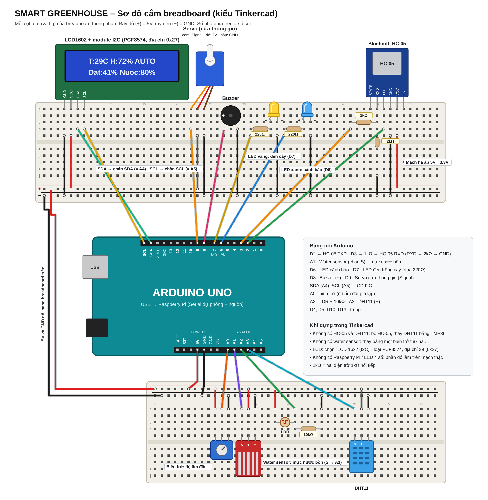
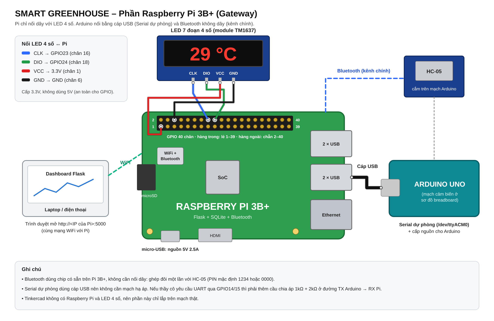

# Smart Greenhouse — Đồ án cuối kỳ IoT Programming (IAD591)

Nhà kính mini tự chăm cây: Arduino Uno đọc cảm biến và điều khiển thiết bị, Raspberry Pi 3B+ làm gateway (Bluetooth + Serial dự phòng), lưu SQLite và chạy dashboard Flask.

| Tầng | Thành phần | Vai trò |
|---|---|---|
| Device | Arduino Uno | Đọc DHT11, LDR, biến trở (độ ẩm đất), water sensor (mực nước); điều khiển servo, 2 LED, còi, LCD I2C; xử lý logic tự động |
| Gateway | Raspberry Pi 3B+ | Nhận dữ liệu qua Bluetooth (chính) / USB Serial (dự phòng, tự chuyển), lưu SQLite, hiện nhiệt độ lên LED 4 số |
| Application | Flask | Dashboard: số liệu hiện tại, mô hình 3D trực tiếp, 5 biểu đồ, lịch sử, xuất CSV, điều khiển |

## Cấu trúc thư mục

```
arduino/smart_greenhouse/smart_greenhouse.ino   Code Arduino chính
arduino/water_servo/water_servo.ino             Code Arduino thứ hai (servo tưới cây)
arduino/test_*/                                 Các sketch test từng phần
raspberry_pi/app.py          Gateway + Flask
raspberry_pi/link.py         Bluetooth / Serial / giả lập, tự chuyển kênh
raspberry_pi/db.py           Truy cập SQLite
raspberry_pi/schema.sql      Database schema
raspberry_pi/tm1637.py       Driver LED 4 số TM1637
raspberry_pi/config.py       Cấu hình (MAC Bluetooth, cổng Serial, chân GPIO)
raspberry_pi/templates, static   Giao diện dashboard (Chart.js đã kèm sẵn, không cần Internet)
docs/breadboard.png          Sơ đồ đấu nối Arduino
docs/raspberry_pi.png        Sơ đồ đấu nối Raspberry Pi
```

## Đấu nối



| Chân Uno | Nối tới |
|---|---|
| D2 | HC-05 TXD |
| D3 | HC-05 RXD qua mạch hạ áp: D3 → 1kΩ → RXD, RXD → 2kΩ (2 × 1kΩ) → GND |
| D4 | LED giả lập bơm qua 220Ω (tuỳ chọn, không gắn cũng được) |
| D6 | LED xanh dương cảnh báo qua 220Ω: sáng cùng lúc còi kêu (bồn cạn hoặc quá nhiệt) |
| D7 | LED vàng (đèn trồng cây) qua 220Ω |
| D8 | Buzzer (+) |
| D9 | Servo cửa thông gió (Signal) |
| A0 | Chân giữa biến trở 10k (hai đầu: 5V và GND) |
| A1 | Water sensor chân S (+ → 5V, − → GND), cắm thẳng đứng trong bồn nước |
| A2 | LDR: 5V → LDR → A2 → 10kΩ → GND |
| A3 | DHT11 DATA |
| A4 / A5 | LCD I2C SDA / SCL |



| LED 4 số TM1637 | Raspberry Pi |
|---|---|
| CLK | GPIO23 (chân 16) |
| DIO | GPIO24 (chân 18) |
| VCC | 3.3V (chân 1) |
| GND | GND (chân 6) |

Arduino cắm cáp USB vào Pi (Serial dự phòng + nguồn). HC-05 kết nối không dây với Bluetooth tích hợp của Pi.

## Arduino thứ hai: servo tưới cây (tuỳ chọn)

Một Arduino Uno riêng chỉ lo việc tưới: servo xoay vòi tưới quét qua lại trên luống cây. Nó nối với Raspberry Pi bằng cáp USB thứ hai và nói chuyện qua Serial.

| Arduino 2 | Nối tới |
|---|---|
| A0 | Servo Signal (dây cam) |
| 5V / GND | Servo đỏ / nâu |
| USB | Một cổng USB khác của Raspberry Pi |

Luồng điều khiển: Arduino chính báo "bơm đang chạy" → Pi gửi `WATER=ON` cho Arduino 2 → servo quét 40°–140°. Bơm tắt → Pi gửi `WATER=OFF` → servo về 0°. Pi gửi lặp lại trạng thái mỗi 2 giây; nếu Arduino 2 không nhận lại lệnh trong 15 giây thì tự dừng tưới.

```
Pi → Arduino 2 :  WATER=ON | WATER=OFF | ANGLE=0..180 | PING
Arduino 2 → Pi :  W,<on>,<góc>   (mỗi giây)      A,<lệnh>,<OK|ERR>
```

Nạp `arduino/water_servo/water_servo.ino` (chỉ cần thư viện Servo có sẵn). Thử riêng bằng Serial Monitor 9600 baud: gõ `WATER=ON`, servo phải quét qua lại; gõ `WATER=OFF`, servo về 0°.

Trên Pi, cổng của Arduino 2 đặt bằng biến `WATER_PORT` (mặc định `/dev/ttyACM1`); đặt `WATER_PORT=` (rỗng) nếu không dùng. Hai Arduino có thể đổi chỗ `ttyACM0` / `ttyACM1` sau khi cắm lại: nếu dashboard báo "Sai cổng Serial" thì đổi `SERIAL_PORT` và `WATER_PORT` cho nhau, hoặc dùng đường dẫn cố định trong `/dev/serial/by-id/`.

## Cài đặt Arduino

1. Arduino IDE → Library Manager, cài: **DHT sensor library** (Adafruit), **Adafruit Unified Sensor**, **LiquidCrystal I2C** (Frank de Brabander).
2. Mở `arduino/smart_greenhouse/smart_greenhouse.ino`, chọn board Arduino Uno, nạp code.
3. Mở Serial Monitor 9600 baud: mỗi giây phải thấy một dòng `D,...`. Gõ `MODE=MANUAL` rồi `PUMP=ON` để thử lệnh.

Địa chỉ I2C của LCD được tự dò khi khởi động; Arduino báo kết quả bằng dòng `E,LCD,<địa chỉ>` (39 = 0x27, 63 = 0x3F, 0 = không tìm thấy).

**Hiệu chỉnh water sensor:** trong Serial Monitor gõ `RAW`, Arduino trả `R,<water>,<soil>,<ldr>`. Ghi giá trị `water` khi cảm biến khô vào `WATER_RAW_EMPTY` và khi ngập tới vạch đầy vào `WATER_RAW_FULL`, rồi nạp lại code.

## Cài đặt Raspberry Pi

```bash
sudo apt update
sudo apt install -y python3-flask python3-serial python3-rpi.gpio bluetooth
sudo usermod -aG dialout,bluetooth $USER     # đăng xuất rồi đăng nhập lại
```

Ghép đôi HC-05 (làm một lần):

```bash
bluetoothctl
  power on
  agent on
  scan on                  # chờ thấy HC-05, ghi lại MAC dạng 98:D3:31:xx:xx:xx
  pair 98:D3:31:xx:xx:xx   # PIN 1234 (hoặc 0000)
  trust 98:D3:31:xx:xx:xx
  quit
```

Chạy gateway:

```bash
cd raspberry_pi
BT_MAC=98:D3:31:xx:xx:xx python3 app.py
```

Mở `http://<IP của Pi>:5000` trên máy cùng mạng (xem IP bằng `hostname -I`).

Các biến môi trường khác: `SERIAL_PORT` (mặc định `/dev/ttyACM0`), `USE_TM1637=0` nếu chưa gắn LED 4 số, `DB_PATH`.

Chạy thử không cần phần cứng (trên PC hoặc Pi):

```bash
pip install flask pyserial
python3 app.py --simulate
```

## Màn hình LCD

| Dòng | Nội dung |
|---|---|
| 1 (cố định) | `T25°C H60% AUTO`: nhiệt độ, độ ẩm không khí, chế độ |
| 2, trang 1 | `Dat: 40% Nc: 80%`: độ ẩm đất, mực nước |
| 2, trang 2 | `Sang: 70% D:BAT`: ánh sáng, đèn |
| 2, trang 3 | `Bom:TAT Gio:DONG`: bơm, cửa gió |

Dòng 2 đổi trang 3 giây một lần. Thông báo sự kiện hiện 2,5 giây; khi bồn cạn, dòng 2 nháy `!! BON NUOC CAN` xen kẽ mỗi giây.

## Logic tự động

| Điều kiện | Hành động |
|---|---|
| Nhiệt độ ≥ ngưỡng nhiệt, hoặc độ ẩm không khí ≥ 85% | Mở cửa thông gió; đóng lại khi nhiệt độ giảm 2°C và độ ẩm ≤ 80% |
| Ánh sáng < ngưỡng tối | Bật đèn; tắt khi sáng hơn ngưỡng 10% |
| Độ ẩm đất < ngưỡng đất khô và bồn còn nước | Bật bơm; tắt khi đất ẩm hơn ngưỡng 10% |
| Lệnh "Tưới ngay" (`WATER=n`) | Bơm chạy n giây rồi tự tắt, ở cả Tự động và Thủ công; dừng sớm nếu bồn cạn |
| Mực nước < 15% | Khoá bơm (cả ở chế độ Thủ công), LED xanh sáng, còi bíp 4 giây/lần, dashboard và LED 4 số cảnh báo |
| Nhiệt độ ≥ ngưỡng nhiệt + 5°C | LED xanh sáng, còi bíp gấp, dashboard cảnh báo |

Ba ngưỡng chỉnh được từ dashboard và được lưu trong EEPROM của Arduino.

## Bơm thật (tuỳ chọn, ngoài danh sách thiết bị của đề bài)

Mặc định chân D4 chỉ điều khiển một LED giả lập bơm. Muốn phun nước thật:

| Linh kiện | Nối |
|---|---|
| Module relay 5V | VCC → 5V, GND → GND, IN → D4 của Arduino |
| Bơm mini 3–6V | Cực (+) của nguồn bơm → COM của relay; NO của relay → dây (+) của bơm; dây (−) của bơm → cực (−) của nguồn bơm |
| Nguồn bơm | Pin hoặc adapter RIÊNG (ví dụ 4 pin AA). Không lấy từ chân 5V của Arduino |

Trong code đặt `#define PUMP_ACTIVE_LOW 1` nếu relay kích mức thấp (đa số module relay 5V). Thử bằng nút "Tưới ngay 10 giây"; nếu bơm chạy ngược (chạy lúc đáng lẽ tắt) thì đổi lại giá trị này. Để bồn nước và ống phun cách xa mạch điện.

## Giao thức Arduino ↔ Pi

Text, mỗi bản tin một dòng, 9600 baud, phát đồng thời trên Bluetooth và USB Serial.

```
Arduino → Pi
  D,temp,hum,light,soil,water,pump,vent,lamp,mode,alarm,tmax,soilMin,lightMin    (1 giây/lần)
  E,<PUMP_ON|PUMP_OFF|VENT_OPEN|VENT_CLOSE|LAMP_ON|LAMP_OFF|TANK_LOW|TANK_OK|BOOT>,<giá trị>
  E,LCD,<địa chỉ I2C, 0 = không tìm thấy>          (một lần khi khởi động)
  A,<lệnh>,<OK|ERR>

Pi → Arduino
  MODE=AUTO|MANUAL
  PUMP=ON|OFF   VENT=OPEN|CLOSE   LAMP=ON|OFF        (đang AUTO thì tự chuyển sang MANUAL)
  WATER=3..60   tưới ngay n giây rồi tự tắt (mọi chế độ, không đổi chế độ)
  TMAX=20..50   SOIL=5..90   LIGHT=5..90   BEEP   PING
  RAW  → Arduino trả R,<water>,<soil>,<ldr> (giá trị analog thô để hiệu chỉnh)
```

Pi nghe cả hai kênh và ưu tiên Bluetooth. Khi Bluetooth im lặng quá 3,5 giây, dashboard tự chuyển sang Serial và ghi sự kiện `LINK` vào lịch sử.

## Kịch bản demo (video 3–7 phút)

1. Quay mạch, LCD và LED 4 số đang chạy.
2. Che LDR → đèn vàng bật. Vặn biến trở xuống thấp → LED bơm bật, vặn lên → tắt.
3. Hà hơi / sưởi DHT11 hoặc hạ ngưỡng nhiệt trên dashboard → servo mở cửa gió.
4. Nhấc water sensor ra khỏi cốc nước → cảnh báo bồn cạn, bơm bị khoá.
5. Dashboard: số liệu, biểu đồ, chuyển Thủ công rồi bật/tắt bơm, cửa gió, đèn.
6. Rút nguồn HC-05 → chấm trạng thái đổi sang "Serial (dự phòng)", cắm lại → về Bluetooth.
7. Tab Lịch sử, bấm "Tải CSV", hoặc `sqlite3 greenhouse.db "SELECT * FROM readings ORDER BY id DESC LIMIT 5"`.

## Xử lý sự cố

| Hiện tượng | Cách xử lý |
|---|---|
| LCD sáng nhưng không có chữ | Xem dòng `E,LCD,n` trong Serial Monitor. `n` khác 0: LCD đã nhận, vặn biến trở xanh sau module I2C tới khi thấy chữ. `n` = 0: kiểm tra dây SDA → A4, SCL → A5, VCC, GND |
| Arduino tự reset khi servo quay | Cấp nguồn 5V riêng cho servo, nối chung GND |
| Nhiệt độ hiện `-1` | DHT11 chưa đọc được: kiểm tra chân DATA (A3) và nguồn |
| Dashboard báo "Mất kết nối" | Kiểm tra cáp USB, `ls /dev/ttyACM*`, quyền nhóm `dialout` |
| Không lên Bluetooth | Đèn HC-05 nháy nhanh = chưa kết nối; kiểm tra `BT_MAC`, ghép đôi lại, kiểm tra mạch hạ áp và TX/RX không bị đảo |
| Mực nước sai | Hiệu chỉnh lại `WATER_RAW_EMPTY`, `WATER_RAW_FULL` bằng lệnh `RAW`; lau khô cảm biến trước khi đo mức "khô" |
